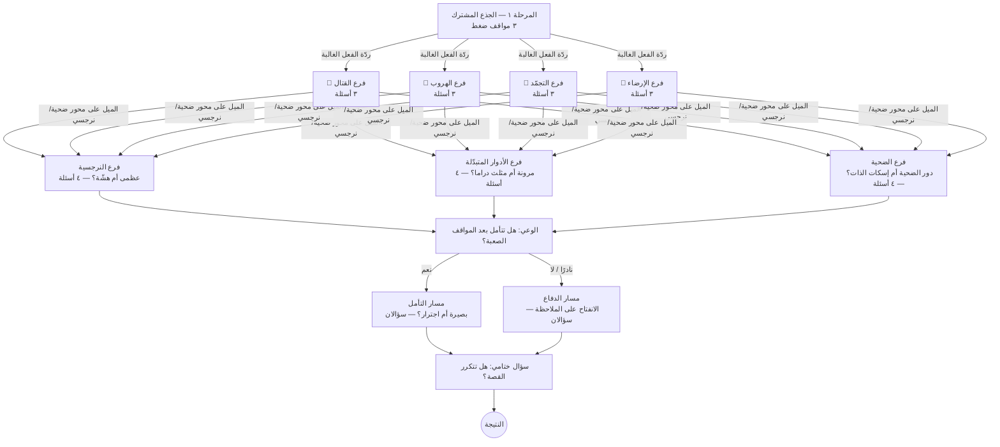

# هل أنت ضحية أم نرجسي في علاقاتك؟

اختبار قصير لتأمل الذات باللغة العربية. يضع المستخدم على مصفوفة من أربعة مربعات
(ضحية / نرجسي × يدرك / لا يدرك)، ويحدد ردّة فعله الغالبة تحت الضغط
(🥊 قتال · 🏃 هروب · 🧊 تجمّد · 🤝 إرضاء).

الأسئلة مبنية على **شجرة**: لا يرى الجميع الأسئلة نفسها، بل تحدد الإجابات الفرع التالي،
على طريقة المقابلات النفسية المنظّمة (أسئلة عامة أولًا، ثم أسئلة متابعة تتعمّق فيما ظهر).

> ⚠️ للتأمل الذاتي فقط، وليس تشخيصًا نفسيًا. «ضحية» و«نرجسي» هنا تصفان ميولًا في السلوك تحت الضغط،
> لا اضطرابًا في الشخصية. الأسئلة مكتوبة خصيصًا لهذا الاختبار ومستوحاة من مفاهيم مدروسة،
> لكن الاختبار نفسه لم يخضع لدراسة صدق وثبات.

## التشغيل

موقع ثابت بلا أي اعتماديات أو خطوة بناء:

- افتح `index.html` مباشرة في المتصفح، أو
- شغّل خادمًا محليًا: `python3 -m http.server 8000` ثم افتح <http://localhost:8000>
- للنشر: أي استضافة ملفات ثابتة (مثل GitHub Pages).

## الملفات

| الملف | المحتوى |
|---|---|
| `index.html` | الشاشات الثلاث: البداية، الأسئلة، النتيجة |
| `css/styles.css` | التصميم (RTL، مناسب للجوال أولًا) |
| `js/data.js` | **كل المحتوى**: عقد الشجرة، المربعات، ردود الفعل، الأنماط الفرعية، المراجع |
| `js/engine.js` | محرّك الشجرة: التوجيه بين الفروع وحساب النتيجة (بلا DOM) |
| `js/app.js` | واجهة المستخدم |
| `scripts/validate-tree.js` | فحص سلامة الشجرة ومحاكاة توزيع النتائج |

## شجرة الأسئلة

كل مسار = ١٤ سؤالًا في أربع مراحل (٣٣ سؤالًا في الشجرة كلها، و٢٤ مسارًا ممكنًا).



**قواعد التوجيه** (في `js/engine.js`):

1. **بعد الجذع:** يُختار فرع ردّة الفعل الأكثر تكرارًا حتى الآن. عند التعادل يُؤخذ أحدث رد بين المتعادلين.
2. **بعد فرع ردّة الفعل:** يُحسب الميل `x / أقصى x ممكن` على المسار حتى الآن:
   أكبر من `0.2` ← فرع النرجسية، أصغر من `-0.2` ← فرع الضحية، وغير ذلك ← فرع الأدوار المتبدّلة.
   الحد قابل للتعديل عبر `leanThreshold` في `js/data.js`.
3. **في مرحلة الوعي:** التفرّع حسب الخيار نفسه (`next` داخل الخيار).

عند الرجوع وتغيير إجابة سابقة يُعاد حساب الفرع التالي، ولا تُحتسب إلا الأسئلة الموجودة على المسار الحالي.

## الحساب

لكل خيار أوزان صريحة: `x` (ضحية − / نرجسي +)، `y` (لا يدرك − / يدرك +)، `r` (ردّة الفعل)، و`t` (وسوم للأنماط الفرعية).

- **المربع:** إشارة مجموع `x` وإشارة مجموع `y` على المسار. تعادل `x` يُحسم بردود الفعل
  (قتال + هروب مقابل تجمّد + إرضاء)، وتعادل `y` يُحسب «يدرك».
- **موقع النقطة:** `x` و`y` بعد قسمتهما على أقصى قيمة ممكنة في المسار، ومحصورة داخل المربع الصحيح.
- **ردّة الفعل:** الأكثر تكرارًا، مع **النمط الهجين** (الرد الثاني) و**النسخة الصحية** منها كما يصفها Walker.
- **التحليل الأعمق:** النمط الفرعي حسب فرع المرحلة ٣ (نرجسية ظاهرة / هشّة، دور الضحية / إسكات الذات،
  مثلث الدراما / مرونة)، وأسلوب الوعي حسب مسار المرحلة ٤ (بصيرة، اجترار، تأمل، انفتاح، دفاعية).
- **مسارك في الشجرة:** تعرض صفحة النتيجة الفروع التي سلكها المستخدم من بين كل الفروع الممكنة.

## تعديل الأسئلة

كل شيء في `js/data.js`. لإضافة سؤال، أضف عقدة إلى `nodes` واربطها عبر `next`:

```js
'fawn-2': {
  module: 'fawn',
  text: 'كم مرة تقول «نعم» وأنت تقصد «لا»؟',
  options: [
    { text: 'معظم الوقت', r: 'fawn', x: -2, t: { silencing: 1 } },
    { text: 'نادرًا، أستطيع الرفض بلطف', x: 0, t: { healthy: 1 } }
  ],
  next: 'fawn-3'            // أو { by: 'response' | 'lean', to: {...} } أو null للنهاية
}
```

ثم شغّل الفحص:

```bash
node scripts/validate-tree.js
```

يتأكد من أن كل انتقال يشير إلى سؤال موجود، وأنه لا توجد حلقات ولا أسئلة يتعذّر الوصول إليها، وأن كل المسارات
بالطول نفسه وتمر بفرع واحد في كل مستوى. ثم يحاكي ٢٠٬٠٠٠ مستخدم يجيبون عشوائيًا ليُظهر توزيع الفروع والنتائج،
ويتأكد من أن كل نتيجة ممكنة الوصول.

## الأساس العلمي

| المرحلة | المفهوم | المرجع |
|---|---|---|
| ١–٢ | ردود الفعل الأربع وأنماطها الهجينة ونسخها الصحية | Walker (2013)؛ Cannon (1915) |
| ٢ | التجمّد ضمن سلسلة الدفاع | Kozlowska et al. (2015) |
| ٢ | النقد والازدراء والانغلاق في الخلافات | Gottman (1994) |
| ٢ | القلق والتجنّب في التعلّق | Fraley, Waller & Brennan (2000) |
| ٢ | العطاء المفرط على حساب الذات | Helgeson & Fritz (1998) |
| ٣ | النرجسية العظمى والهشّة | Pincus et al. (2009)؛ Miller et al. (2011) |
| ٣ | «الإعجاب» و«التنافس» في النرجسية | Back et al. (2013) |
| ٣ | النرجسية شديدة الحساسية | Hendin & Cheek (1997) |
| ٣ | السؤال المباشر «هل أنت نرجسي؟» | Konrath, Meier & Bushman (2014) |
| ٣ | الميل المزمن إلى دور الضحية | Gabay et al. (2020) |
| ٣ | إسكات الذات | Jack & Dill (1992) |
| ٣ | مثلث الدراما (نموذج علاجي، لا مقياس محكّم) | Karpman (1968) |
| ٤ | التأمل مقابل البصيرة | Grant, Franklin & Langford (2002) |
| ٤ | التأمل مقابل الاجترار | Trapnell & Campbell (1999) |
| ٤ | التعقّل (فهم ما في ذهنك وذهن الآخر) | Fonagy et al. (2016) |

المراجع الكاملة موجودة في `js/data.js` (`references`) وتظهر في صفحة النتيجة تحت «على ماذا يستند هذا الاختبار؟».

---

**English summary:** A static, dependency-free Arabic (RTL) self-reflection quiz, "Are you a victim or a narcissist in
your relationships?". Questions form a branching tree (14 per path, 33 in total, 24 possible paths): a shared stem of
stress scenarios routes to a fight/flight/freeze/fawn follow-up branch, then to a narcissism, victimhood or mixed-roles
branch depending on the running score, then to a reflection or defensiveness branch. Results place the user on the 2×2
matrix and report their dominant stress reaction, a subtype and an awareness style, each tied to the psychology
literature listed above. Run `node scripts/validate-tree.js` after editing `js/data.js`. Not a diagnostic instrument.
